<p align="center">
  
</p>

<p align="center">
  
  
  
  <br>
  
  
  
</p>

<h3 align="center">Your phone already knows how long you scroll.<br>MindLol tells you, with a judgmental little blob and zero mercy.</h3>

<p align="center">
  <a href="#-features">Features</a> •
  <a href="#-screens">Screens</a> •
  <a href="#-how-it-works">How it works</a> •
  <a href="#-getting-started">Getting started</a> •
  <a href="#-roadmap">Roadmap</a>
</p>

---

<table align="center">
  <tr>
    <td align="center" width="38%">
      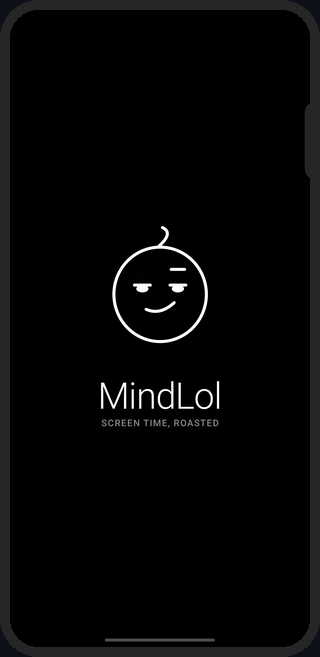
    </td>
    <td align="center">
      
      <br><br>
      <b>Meet the mascot.</b> A black-and-white blob drawn entirely on a Compose <code>Canvas</code>.<br>
      Its face is just numbers (eye openness, mouth curve, brows), so moods <i>morph</i> into each other instead of swapping.<br>
      It breathes, it blinks, and it gets <b>smug</b> when you cheat.
    </td>
  </tr>
</table>

## ✨ Features

| | |
|---|---|
| 📊 **Real screen time** | Per-app time built from raw Android usage events, split at *your* local midnight. Today's numbers match Digital Wellbeing per app. |
| 📈 **Stats that move** | Day / week / month / year, with a hand-drawn Canvas bar chart that rises bar by bar whenever you switch period. |
| 🔓 **Unlock counter** | Counts every time you dismiss the lock screen (Android 9+). |
| 🗂️ **History that sticks** | Android forgets raw events after about a week. MindLol saves them to an on-device Room database every 6 hours. |
| 🕰️ **Day-one history** | On first launch, it imports the older daily, weekly, monthly and yearly summaries Android still keeps, clearly marked as estimates. |
| 😏 **A mascot with moods** | Neutral, sleepy, smug, dramatic, picked from how your day is going. |
| 🧾 **Cheat log & roasts** | *"Bedtime was 11. Instagram disagreed."* Every broken rule, logged and roasted. <sub>(still fake data, Phase 3–4)</sub> |
| 🔒 **100% on device** | No internet permission, no accounts, no analytics. Your scrolling shame never leaves the phone. |
| 🎞️ **Motion first** | Count-up numbers, staggered reveals, directional tab transitions. All of it respects the system animation speed. |
| 🖤 **Strictly monochrome** | Every Material color slot is locked to black, white and gray. Not a single purple pixel. |

## 📱 Screens

<p align="center">
  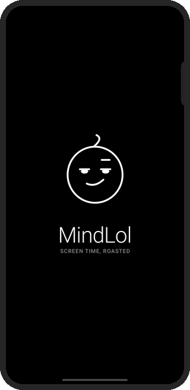
  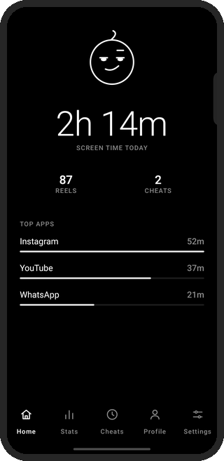
  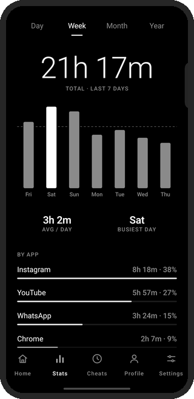
  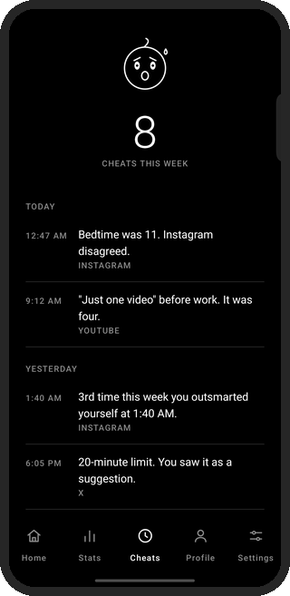
  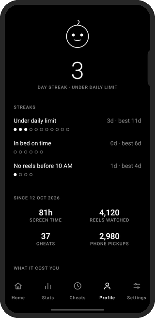
</p>
<p align="center">
  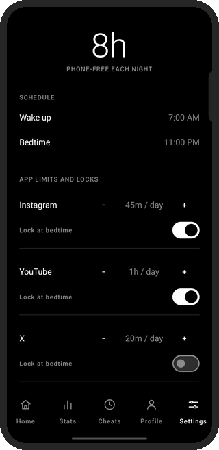
  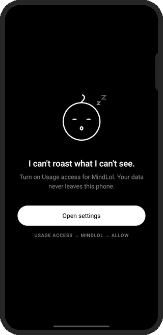
</p>
<p align="center"><sub>Splash · Home · Stats · Cheat log · Profile · Settings · Usage-access onboarding. The screenshots use the Phase 1 demo data.</sub></p>

## 🧠 How it works

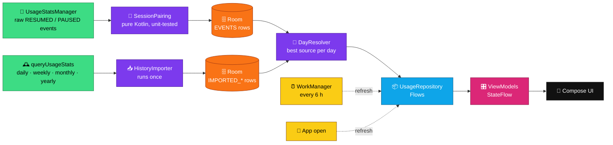

<details>
<summary><b>🔬 The details that make the numbers right</b></summary>

- **Events, not buckets.** `totalTimeInForeground` buckets don't line up with local midnight. On the test phone they run 22:00 to 22:00. So daily numbers come from pairing raw events.
- **Midnight crossing.** A session from 23:50 to 00:20 counts as 10 minutes for one day and 20 minutes for the next.
- **Missing events.** A `PAUSED` with no `RESUMED` before it means the app was already open, so it counts from the start of the day. An app with no `PAUSED` yet counts until now, and screen-off closes everything.
- **Overlaps count once.** Split-screen time goes to both apps, but the daily total is the *union* of sessions.
- **Honest exclusions.** The launcher and MindLol itself are left out of rankings and totals.
- **Unknown ≠ zero.** Below Android 9, unlocks are stored as `null`, not `0`.
- **Idempotent writes.** Each sync replaces a day's rows inside a transaction, so running it twice changes nothing.
- **Source priority.** `EVENTS` › `IMPORTED_DAILY` › weekly › monthly › yearly. Estimated periods are labeled in the UI.

</details>

## 🛠️ Tech stack

| Layer | What |
|---|---|
| Language | Kotlin 2.4.20 (AGP 9.5.0 built-in Kotlin), JDK 17 |
| UI | Jetpack Compose (BOM 2026.09.00), Material 3, Navigation Compose 2.10.2 |
| Architecture | MVVM, a single `UsageRepository`, manual DI through `AppContainer` (no Hilt) |
| Data | Room 2.8.5 with KSP 2.3.13, exported schema in `app/schemas/` |
| Background | WorkManager 2.12.0, a periodic sync limited to battery-not-low |
| Async | Kotlin Coroutines and Flow (`StateFlow`, `combine`, `flatMapLatest`) |
| Tests | JUnit 4 JVM tests for session pairing, hourly splits and source resolution |
| Android | minSdk 26 · targetSdk 36 · compileSdk 37 |

## 🗂️ Project structure

```text
app/src/main/java/com/abhijith/mindlol/
├── MainActivity.kt · MindLolApplication.kt · AppContainer.kt
├── data/
│   ├── db/            Room entities, DAO, database
│   ├── usage/         permission, event reader, session pairing, history import, app names
│   ├── repository/    UsageRepository, DayResolver, FakeData (Phase 3–4 parts)
│   └── prefs/         small on-device flags
├── domain/            shared models
├── worker/            UsageSyncWorker (WorkManager)
└── ui/
    ├── theme/         monochrome colors, type, Motion tokens
    ├── components/    Mascot, UsageBarChart, PeriodSelector, reveal animations…
    ├── navigation/    NavHost, bottom bar, screen transitions
    └── screens/       splash · onboarding · home · stats · cheatlog · profile · settings
```

## 🚀 Getting started

**You need:** JDK 17, the Android SDK (platform 37) and a phone with USB or wireless debugging. Android Studio is optional; everything runs from the terminal.

```bash
git clone https://github.com/abhi-jithb/MindLol-App.git
cd MindLol-App

./gradlew assembleDebug        # build
./gradlew testDebugUnitTest    # run the unit tests
./gradlew installDebug && adb shell am start -n com.abhijith.mindlol/.MainActivity
```

Then grant **Usage access**. Android has no popup for it:

> MindLol → **Open settings** → Usage access → **MindLol** → Allow

The app switches to your real numbers as soon as you come back.

> [!TIP]
> **On Vivo / OriginOS** (and other phones that kill background apps), turn on **Autostart** for MindLol and allow **background battery use**, so the 6-hour sync keeps your history. *Settings → Keep tracking in the background* inside the app walks you through it.

## 🗺️ Roadmap

- [x] **Phase 0:** project setup, Compose, edge-to-edge, black & white theme
- [x] **Phase 1:** UI shell: mascot, splash, five screens, Canvas charts, motion system (fake data)
- [x] **Phase 2:** real usage data: events → Room, history import, repository + ViewModels, background sync
- [ ] **Phase 3–4:** real cheats, reels, mascot moods and roast lines (rules engine + roast generator)
- [ ] **Phase 5:** Room migrations, guarded by the exported schemas

## 🔐 Privacy

MindLol doesn't request the `INTERNET` permission. Usage data is read with Android's own usage-access permission, stored in a local database, and never leaves the phone. The extra permissions in the merged manifest (`WAKE_LOCK`, `RECEIVE_BOOT_COMPLETED`, `ACCESS_NETWORK_STATE`, `FOREGROUND_SERVICE`) come from WorkManager, which uses them to schedule the background sync.

<p align="center">
  
</p>

<p align="center">
  <sub>Built by <a href="https://github.com/abhi-jithb">abhi-jithb</a>, one Compose screen and one roast at a time.</sub>
</p>
